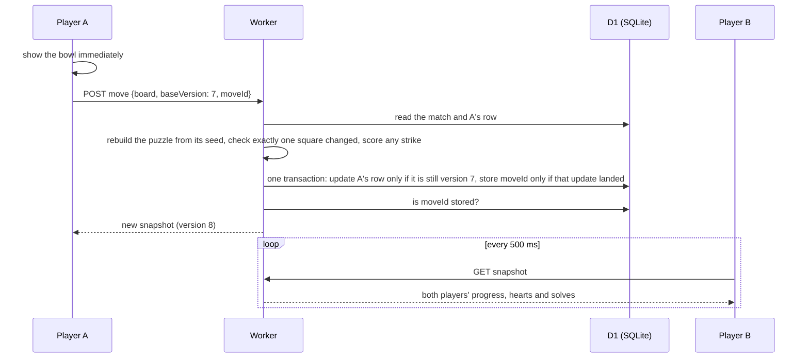
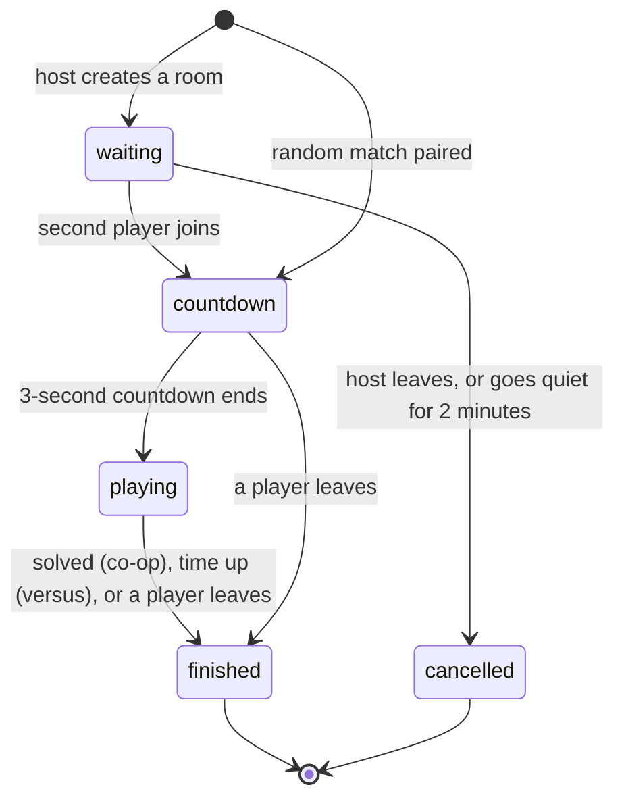

# How multiplayer works in Biscuit's Bowls

Biscuit's Bowls is a
logic-puzzle game: place food bowls so every cat has exactly one neighbouring
bowl. Its multiplayer has two modes:

- **Relaxed co-op:** two players work on one shared board.
- **Timed versus:** each player races through the same sequence of puzzles for
  three minutes, and the most solves wins.

Players can match with a stranger or share a six-character room code with a
friend, then rematch, react with emotes, and rejoin if they drop out.

All of it runs on one HTTP endpoint and one SQLite database, with no
long-lived connections and no background jobs. This page explains how that
stays correct when two phones act at the same moment. The game's source is
private ahead of an iPhone release, so the snippets below are simplified.

## At a glance

- **Server:** a Cloudflare Worker with one endpoint, `/api/multiplayer`. `GET`
  returns the player's current match or queue status, and `POST` takes an
  action: create, join, random, cancel queue, move, emote, rematch, cancel
  rematch, leave.
- **Database:** Cloudflare D1 (SQLite), with seven tables: matches, players,
  queue tickets, active players, move ids, rematch votes and emotes.
- **Sync:** the client polls every 500 ms during a countdown or match, and
  every 1.2 s otherwise.
- **Authority:** the server rebuilds every puzzle and checks every move. In
  versus, a player never receives the opponent's board, only their progress,
  hearts and solves.
- **Tests:** 77 automated tests in nine files exercise this code, all passing
  on 30 October 2026. Four race scenarios force specific interleavings by
  pausing a query partway through a request.



## The same puzzle on both phones, without storing it

A match stores one random 32-bit seed, and puzzle *n* of the match is generated
from the seed and *n*. Both players get identical boards, and the server can
rebuild any puzzle on demand to check a move. Rebuilt puzzles are memoised.

When two players are paired, the server freezes a **puzzle contract** for the
match:

- the generator version;
- whether it is a versus or co-op match;
- the mechanics **both** players have actually met in the campaign (food
  preferences, serving hatches, movable furniture).

Freezing the contract has three effects:

- Nobody is handed a mechanic they haven't learned.
- Progress a player makes elsewhere during the match can't change the next
  board.
- Old matches still rebuild exactly, because earlier generator versions stay
  available.

Versus puzzles get harder as a player moves through the sequence, and co-op
uses one fixed, more involved difficulty. A rematch always gets a different
seed from the match before it.

## The server checks every move

After a tap, the client sends its whole board, the version it was looking at,
and a move id it generated. The server rebuilds the puzzle and compares the two
boards:

- **Exactly one square may differ, and it must be one players are allowed to
  change.** That rules out the obvious cheat of posting a solved board.
- **Furniture moves** are checked against the furniture's fixed tracks.
- **Strikes are scored by the server.** In versus, a bowl that overfeeds a cat
  costs a heart.

In versus, a solve moves you to the next puzzle with a point, and three strikes
move you on without one.

## Applying a move exactly once

Phones lose responses. If a move reaches the server but the reply doesn't come
back, the client sends the same move again, with the same move id. Three things
make that safe:

1. **Move ids are remembered.** If the server has already stored a move id for
   this player and match, it returns the current state without applying
   anything.
2. **The write is conditional.** The update only succeeds if the row is still
   at the version the client saw, still holds the exact board the server just
   validated, and the match is still running. A move that read stale data
   changes nothing.
3. **The move id is stored only if that update landed**, in the same
   transaction:

```sql
-- Apply the move only if nothing changed since it was validated.
UPDATE multiplayer_players
   SET board_json = :next_board, revision = revision + 1, last_nonce = :move_id
 WHERE match_id = :match AND user_id = :me
   AND revision   = :base_revision
   AND board_json = :board_that_was_validated
   AND left_at IS NULL
   AND EXISTS (SELECT 1 FROM multiplayer_matches
                WHERE id = :match AND status = 'playing'
                  AND deadline_at > /* SQLite's own clock, in ms */ :db_now);

-- Record the move id only if the update above is what changed the row.
INSERT INTO multiplayer_move_nonces (match_id, user_id, nonce, created_at)
SELECT :match, :me, :move_id, :now
 WHERE EXISTS (SELECT 1 FROM multiplayer_players
                WHERE match_id = :match AND user_id = :me
                  AND revision = :base_revision + 1 AND last_nonce = :move_id);
```

Afterwards the server asks one question: is this move id stored? That answer is
correct whether the move won, lost a race, or is a retry of one that already
landed. If it lost, the player gets a 409 and a plain message: "The board
changed; refresh and try again."

The deadline check in the versus write uses the database's own clock, not the
Worker's. So a move that passed the Worker's check just before time ran out
still can't land after it.

## Races, and how the database settles them

Each multi-statement change (pairing, joining a room, a move, a rematch,
leaving) runs as a single D1 batch, which is one transaction. Each statement in
it is guarded by the state it expects. Unique keys do the
rest: each player can be in only one live match, and each finished match can
have only one rematch.

| Race | What settles it |
|---|---|
| Two queued players each try to pair with the other | A player may only pair with a ticket older than their own, so of any two, only the later arrival creates the match. If a double pairing slips through anyway, the one-live-match key fails the batch, it rolls back, and the next queue poll tries again. |
| Two people join the same room at once | The join statements require the room to still be waiting with no guest. Afterwards the server re-reads the room, and if the result isn't exactly two players it cancels and tells the late joiner "That room was just filled or closed." |
| Both players' requests create the rematch at the same moment | The rematch's link to its parent match is unique, so the second insert fails and that request picks up the match the first one made. |
| One player leaves while the other's rematch vote lands | The leave marks the player gone across the whole chain of rematches in the same transaction, then follows the chain if a new match appeared in the meantime. A departed player can't be pulled into a new match. |
| A move arrives while the pair's puzzle is being swapped in | Right after a random pairing, the match already exists on a provisional puzzle while the server reads both players' campaign progress. The pair's puzzle replaces it only if nobody has moved yet, checked in the same statement. A move already in flight is refused, because the board it validated has changed. |
| A poll reads while a solve advances to the next puzzle | The player's board, version and puzzle number come from a single row read, so a snapshot can't pair the new puzzle with the old board. |

## Time without timers

There is no scheduler. Status changes happen when a request notices they're
due:



Every snapshot first promotes a countdown to playing once its start time has
passed. It also finishes a versus match whose three minutes are up, working out
the result in the same SQL statement:

- more solves wins;
- a player who left loses;
- equal solves is a draw.

Each of these updates names the status it expects. If both players' polls
notice the deadline at once, only the first write takes effect.

Housekeeping runs when someone creates, joins or queues for a match, not on
every poll. It does four things:

- cancels waiting rooms whose host hasn't been seen for two minutes;
- drops queue tickets that haven't been renewed for 30 seconds;
- clears expired emotes;
- forgets rematch votes after ten minutes.

## Feeling instant on a 500 ms poll

Every tap shows immediately. The client keeps the last snapshot the server
confirmed plus a short list of pending moves, and draws the board as that
snapshot with the pending moves applied on top. Moves go to the server one at a
time:

- **Pending moves record the value a square should end up with** ("fish bowl
  on square 17"), not "toggle square 17". A poll that already includes the
  move can't flip it back.
- **Poll responses can arrive out of order.** One with a lower version than
  what's on screen is ignored, and an older read never undoes the opponent's
  newer hearts or solves.
- **If the server rejects a move,** the client drops it, says so, refreshes,
  and replays the remaining pending moves on the fresh board.
- **If the network drops,** pending moves stay on screen and resume after the
  next successful poll.
- **The clock is the server's.** Each snapshot carries the server time, and
  the client keeps the offset, so the countdown and the three-minute clock are
  right even on a phone whose clock is wrong.

## Dropping out and coming back

A match lives in the database, not in a connection. Closing the app doesn't
forfeit: reopening multiplayer finds the player's live match and puts them back
at their table with their board as they left it. The versus clock keeps
running. The opponent sees them as disconnected after 15 seconds without a
poll.

## Other guard rails

- Writes from other websites are rejected by an Origin check, request bodies
  are capped at 12,000 bytes, and every request needs a signed-in player.
- Room codes leave out look-alike characters (0, O, 1, I) so they're easy to
  read out loud.
- Errors use proper status codes and plain sentences: 409 for a lost race, 429
  for emotes sent too quickly.
- Emotes are limited to one every two seconds per player. The limit is enforced
  inside the insert itself, and each emote shows for eight seconds.

## How it's tested

A test fixture loads the real server module and runs it against Node's built-in
SQLite in place of D1, so the SQL under test is the SQL that runs in
production.

The four race tests go a step further. Each one pauses a specific query partway
through a request (matched by its SQL text), runs a competing request to
completion, then lets the first request finish. One of them pauses a poll just
before it reads the player's row, lands a real solve in the gap, and checks that
the poll returns a consistent pairing of puzzle and board, never a mix.

## Trade-offs and next steps

- **Polling costs.** It runs on plain request-and-response infrastructure and
  survives flaky mobile networks, but an opponent's move can take up to half a
  second to appear, each player makes about 360 polls in a three-minute match,
  and every poll also writes a last-seen time. On Cloudflare, Durable Objects
  with WebSockets would push changes the moment they happen and keep each
  match's state in memory. That's the natural next step.
- **Sign-in.** Accounts come from the game's current hosting platform, so the
  iPhone release needs its own sign-in.

*TypeScript · Cloudflare Workers · D1 (SQLite) · Drizzle ORM · Node's test runner*
